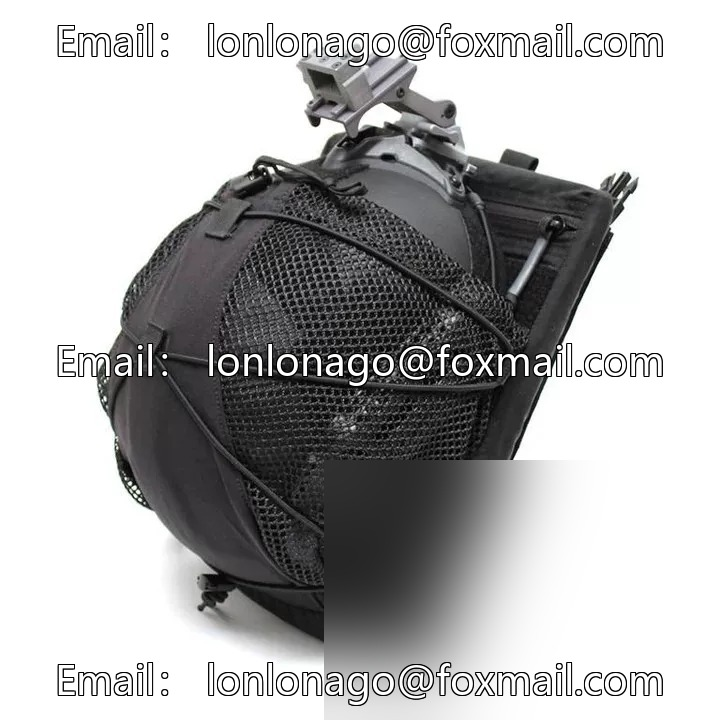
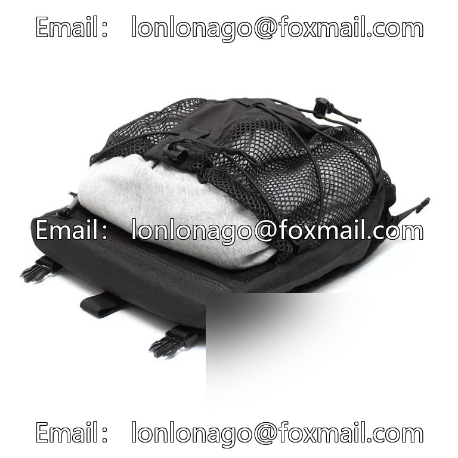

# LBX-4040C Tactical jumping board, for Armat

## Body

LBX-4040C Tactical Bouncer, designed for the Armatus II carried vest.
Modular design, using a bag + clutter bag + water bag combination; the bag holds equipment quickly, the clutter bag organizes tools in separate compartments, and the water bag is compatible with the main water bag system.
Lightweight design, with a self-weight of only 0.6kg, 20% lighter than similar bouncers. Airproof mesh material, large-area neoprene fasteners for connection, suitable for high-temperature and high-movement environments.
Fully unused, suitable for tactical missions and outdoor sports scenarios.
Note: Helmets and clothing are only for display and are not sold with the product.
Military enthusiast tactical equipment, bungee jumping equipment

The images show the modular design, combined packing system, lightweight feature, breathable mesh material, connection method and applicable scenarios for tactical tasks and outdoor sports.

<!-- AI_ENRICHED -->

## Images

## Payment

Here is a pay link on Stripe ( https://buy.stripe.com/3cs8yP7sY87d0vu9AB ). Please contact me lonlonago@foxmail.com after funding $89, and I will send you a complete data files , thank you!

